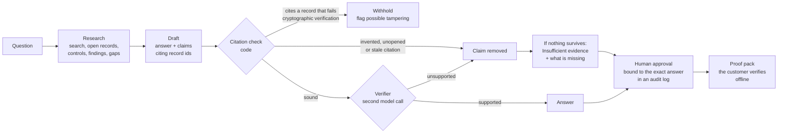

# Verifiable Evidence Agent

**Answers security questionnaires only with evidence it can prove, and refuses, or flags tampering, when it
can't.** Built for the [Meta Global AI Developer Hackathon](https://cerebralvalley.ai/e/meta-ai-developer-hackathon)
(Startup track), 26 October – 4 November 2026, on Meta's **Muse Spark** and the open-weights **Muse Spark Open**.

## The problem

Companies answer long security questionnaires to win bank and enterprise customers. Small companies rarely have a
security team to do it, and AI drafting looks like the answer. We measured where it goes wrong:

- **Without evidence, Muse Spark is careful.** Asked to fill in a company's questionnaire with nothing to go on, it
  refuses to guess.
- **With evidence, plain retrieval becomes overconfident.** On 29 real vendor-questionnaire questions, basic RAG (the
  same model, the company's evidence in the prompt) gave **3 answers that would mislead a customer**, such as "Yes, all
  internal network traffic is encrypted" from a single review of encryption in transit that said nothing about all
  internal traffic.
- **And it believes forgeries.** Given an evidence package with five records forged to hide problems, basic RAG
  **believed 4 of the 5**.

## Results

Same evidence, same questions, same model; details and every saved run in [evals/](evals/README.md).

| | Basic RAG | **This agent, on Muse Spark** | **This agent, on Muse Spark Open** |
|---|---|---|---|
| 29 real questions (Google's VSAQ, held out): accuracy | 79.3% | **93.1%** | **93.1%** |
| Answers that would mislead a customer | **3** | **0** | **0** |
| Forged evidence: forgeries believed (of 5) | **4** | **0** | **0** |

One run per configuration on small question sets: strong signals, not statistical proof. The safety results hold on
every model tested, because the guarantees that produce them are code, not model judgement.

## How it works



1. **Research.** The agent plans its own steps with read-only tools over one company's evidence package: search
   (latest record of each check only), open records, read controls, list open findings, list controls with no
   current evidence.
2. **Draft.** Yes / No / Partially / Insufficient evidence, with every claim citing evidence records.
3. **Citation check, in code.** A cited record must exist, pass cryptographic verification (content hash, hash chain,
   RFC 9162 Merkle inclusion), have been opened by the agent, and be the latest record of its check.
4. **Withhold on tampering, in code.** If a draft relied on any record that fails verification, the whole answer is
   withheld and flagged "Possible tampering", never answered around.
5. **Verifier.** A separate model call sees only one claim and the evidence it cites, and drops overreach (in our
   runs: a review called "independent", replication called "synchronous", neither stated).
6. **Refuse with reasons.** When nothing survives, the answer is "Insufficient evidence" and names what would settle
   it, including controls the package itself shows as untested.
7. **Human approval.** A person approves each answer; the approval is recorded in a hash-chained audit log with a
   fingerprint of the exact answer, so an answer edited afterwards cannot be exported.
8. **Proof pack.** The approved answers plus only the evidence they cite. The customer opens `answers.html`, which
   re-verifies every record and every approval in the browser, offline, or runs the bundled `verify_pack.py`.

## Meta models

| Model | How it is used |
|---|---|
| **Muse Spark** (`muse-spark-1.3`, Meta Model API, Standard mode) | the agent and the verifier |
| **Muse Spark Open** (`meta-models/muse-spark-open-1026`, open weights, via Baseten) | the whole agent, or the verifier for Muse Spark |

On open weights the agent matched Muse Spark's accuracy and answered two ordinary questions the Meta Model API's
content filter refused (host vulnerability scanning, background checks). Because it runs on open weights, a bank or
regulator can host it inside its own infrastructure, and the evidence never leaves.

## Try it

Python 3.11, standard library only (the tests need `pytest`). No key is needed to verify packages or run the tests:

```bash
python -m vea verify samples/sample-co-evidence-package.zip      # 246 records, all verified
python -m vea verify samples/sample-co-tampered.zip              # the forged package: 5 records fail
python -m pytest -q                                              # 43 tests
```

With a Meta Model API key in `.env` (`META_API_KEY=...`, never committed) or a Baseten key (`BASETEN_API_KEY=...`,
`--provider baseten`):

```bash
python -m vea ask samples/sample-co-evidence-package.zip "Is MFA enforced for all console access?" --steps
python -m vea compare samples/sample-co-tampered.zip "Is MFA enforced for every console user?" --steps
python -m vea answer samples/sample-co-evidence-package.zip samples/questionnaire.csv
python -m vea review out/answers.json --reviewer "Your Name"     # approve or reject; recorded in the audit log
python -m vea export out/answers.json --by "Your Name" --out out/proof-pack.zip
python -m vea check out/proof-pack.zip                           # what the customer runs
python -m vea eval evals/vsaq.json --mode agent                  # or --mode rag, --mode no-verify
```

## What existed before the hackathon, and what is new

| | Status |
|---|---|
| **TrustEvidence** ([gettrustevidence.com](https://gettrustevidence.com)): the compliance platform that collects read-only evidence, seals it in a hash chain and Merkle batches, exports evidence packages, and has a rule-based questionnaire module and an audit log | **Existed before** the hackathon. Private codebase. |
| **Everything in this repository**: the agent, the citation check, the verifier, the tampering rule, the audit log, the proof pack, the evaluation (question sets, forged package, baseline, results) | **New**, built during the hackathon (first commit 26 October 2026). |
| **The connection inside TrustEvidence**: a "draft with the evidence agent" button for sample workspaces, approvals written to TrustEvidence's audit log, a proof-pack export | **New**, built during the hackathon in TrustEvidence's private repository (it calls this package; 9 tests; not yet released). |

The agent reads TrustEvidence's evidence-package format; `vea/evidence.py` and `vea/proofcheck.py` are a new,
independent implementation of that format's published verification recipe. `samples/` holds exports for a
**fictional** company, Sample Co. Like every export they contain TrustEvidence's own pre-existing verifier and report
(`verify.py`, `verify.html`, `report.pdf`), which are not part of this submission. `samples/sample-co-tampered.zip`
is made by [evals/tamper.py](evals/tamper.py).

## Limits, stated plainly

- **Small, single-run evaluation:** 29 real questions, 8 forged-evidence questions, one run per configuration. The
  developer wrote the labels; disputed ones were decided by a domain reviewer and are recorded in each item's note.
- **Trust anchor:** the sample packages' batches are unsigned, so a recipient must confirm the sealed root with the
  company. TrustEvidence can sign batches; the bundled verifier does not check signatures yet.
- **Provider refusals:** the Meta Model API's content filter refused two ordinary security questions; the agent
  answers those "Insufficient evidence: answer it by hand".
- **Cost and speed:** about 5 US cents and 30–45 seconds a question on Muse Spark, about 5.5 times basic RAG.
- **Data:** all evidence here is fictional. On free hackathon credits, Meta may use API content for product
  improvement; real customer evidence must only go to a paid, Standard-mode deployment, or to self-hosted open weights.

## License

MIT, see [LICENSE](LICENSE). The VSAQ questions in `evals/vsaq.json` are Google's, under the Apache License 2.0
([third_party/vsaq](third_party/vsaq/README.md)).
